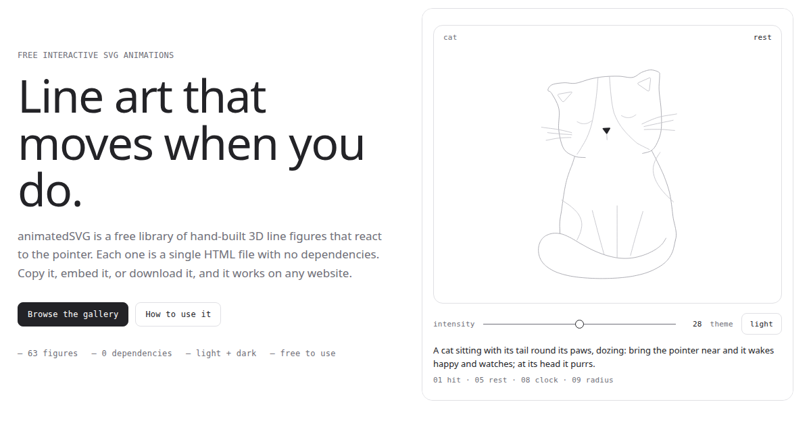
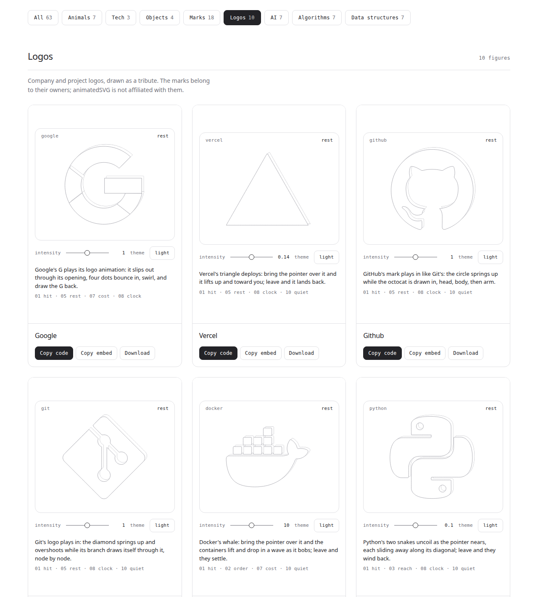

<div align="center">

# animatedSVG

**Line art that moves when you do.**

Free, hand-built 3D line figures that react to the pointer. Each one is a single HTML file with no dependencies: copy it, embed it or download it, and it works on any website.

[**Browse the gallery →**](https://animatedsvg.vercel.app)


[](LICENSE)

<a href="https://animatedsvg.vercel.app"></a>

</div>

---

## What it is

Every figure is an isometric line drawing that answers the pointer. A cat wakes up and turns its head to watch you. The Arch logo builds itself from blocks. A min-heap sifts a new value up to its root. Google's G slips out through its opening and draws itself back on.

- **One file per figure.** Markup, styles, the engine and the figure, all inlined. No build step, no npm, no CDN.
- **Reacts to the pointer**, and plays only while you hover. Leave and it settles back to rest.
- **Light and dark** themes, following the reader's system setting by default.
- **Respects reduced motion.** Figures go straight to their final pose for readers who asked for less motion.
- **Sharp at any size.** It's all SVG.

## The gallery

<a href="https://animatedsvg.vercel.app"></a>

| Section | Figures |
|---|---|
| **Animals** | cat · dog · hedgehog · turtle · birds · fish · frog |
| **Tech** | speaker · ceiling (a rate limiter) |
| **Objects** | book · bookshelf · gaze · surprise |
| **Marks** | Ubuntu · Debian · Fedora · Arch · Manjaro · NixOS · Zorin · Mint · Red Hat · Kali · openSUSE · Pop!_OS · elementary · Gentoo · EndeavourOS · CentOS · Rocky · Alma |
| **Logos** | Google · Vercel · GitHub · Git · Docker · Python · React · Node.js · Rust · Kubernetes |
| **Languages** | Java · C · C++ · C# · JavaScript · PHP · Go · Swift · Kotlin · HTML5 |
| **Social** | Instagram · Facebook · Twitter · X · LinkedIn · YouTube · WhatsApp · TikTok · Reddit · Discord · Snapchat · Pinterest · Telegram |
| **Dev brands** | VS Code · Figma · Slack · Notion · Spotify · npm · AWS · Firebase · PostgreSQL · Redis |
| **Games** | game controller · Pac-Man ghost · Tetris · Minecraft block |
| **AI** | Claude's spark · Clawd · the thinking spinner · terminal · tool loop · subagents · context window · neural net · attention map · token stream |
| **Data structures** | stack · queue · linked list · binary search tree · min-heap · hash table · graph |
| **Algorithms** | binary search · bubble sort · call stack · recursion tree · git branches · packet routing · CPU cache · quicksort · Dijkstra · binary byte |
| **Everyday** | desk lamp · coffee mug · envelope · wall clock · potted plant |
| **Computer** | CPU · graphics card · motherboard · RAM · M.2 SSD · hard drive · power supply · PC case · monitor · laptop · keyboard · mouse |
| **Food** | espresso machine · toaster · pizza · ramen |
| **Transport** | bicycle · paper plane · toy train · car wipers |
| **Nature** | oak · flower · mushroom · campfire |
| **Music** | turntable · piano · metronome · cassette |
| **Space** | rocket · ringed planet · satellite dish · moon phases · black hole · comet · astronaut |
| **Weather** | rain cloud · sun · weathervane · umbrella |
| **Dev tools** | server rack · database · CI pipeline |
| **Anime** | One Piece: straw hat · Gum-Gum Fruit · Jolly Roger · Going Merry · Bleach: Hollow mask · Zangetsu · Senbonzakura · Sode no Shirayuki |

Each figure has its own move. A few favourites:

- **Kali**: the dragon slithers in along its spine, the bone grows, then the wings unfold.
- **Hash table**: a dial counts each key out mod 3, and the key drops into the bucket the needle stops on.
- **Queue**: the front block lifts out, glides back along the side and rejoins at the back.
- **Context window**: tokens fill the tray, then fold into a single summary block.

## Use a figure

Open the [gallery](https://animatedsvg.vercel.app), hover a figure, then pick one of three buttons:

| Button | What you get |
|---|---|
| **Copy embed** | An `<iframe>` that loads the figure from this site. The quickest option. |
| **Copy code** | The whole self-contained HTML file, to host yourself. |
| **Download** | The same file, saved to disk. |

```html
<iframe src="https://animatedsvg.vercel.app/hairline-cat.html"
        title="cat" width="640" height="560" style="border:0" loading="lazy"></iframe>
```

### URL options

Every figure page reads a few query parameters:

| Parameter | Example | Effect |
|---|---|---|
| `theme` | `?theme=dark` | Force `light` or `dark` instead of following the system. |
| `intensity` | `?intensity=0.8` | Set the slider, from `0` to `1`. What it controls depends on the figure (lift, speed, sway and so on). |
| `w` | `?w=360` | Cap the figure's width, in pixels. |
| `at` | `?at=200,160` | Hold the pointer at a point of the 400 × 320 drawing, for screenshots. |

Combine them like this: `hairline-kali.html?theme=dark&intensity=1`.

## How it works

The figures are drawn with [Hairline](https://github.com/lucasmarkes/hairline), a tiny engine for isometric line drawing by Lucas Marques. A figure is built from rounded solids, each one a silhouette and a single crease. Parts are painted back to front, so nearer ones cover farther ones. The only highlight is one brighter stroke on the part under the pointer.

Motion runs on springs and tweens through a single animation loop. There are no timers and no CSS keyframes, so a figure is completely idle when nothing is moving.

The animated logos follow their real outlines, from [simple-icons](https://simpleicons.org). Where a logo has a well-known animation, such as Google's or Git's, the timing was measured from it frame by frame.

## Project layout

```
index.html              the gallery site
hairline-<name>.html    a built figure: self-contained, what you copy or embed
<name>.js               that figure's source code, the part you edit
og.png                  the social preview image
THIRD_PARTY_NOTICES.txt the Hairline engine's license
```

Each figure has two files: the editable source (`cat.js`, about 100–200 lines) and the built page (`hairline-cat.html`), which inlines the engine so it runs on its own.

## Run it locally

```bash
git clone https://github.com/itssanketh/animatedSVG.git
cd animatedSVG
python3 -m http.server
```

Then open <http://localhost:8000>. Any static file server works, since there's nothing to install or build.

## Make your own figure

Figures are written against Hairline's figure API: a `mount({ stage, svg, read }, value)` that returns `{ set, destroy }`, ending in a `hairline({ name, means, rules, range, mount })` call. Write `<name>.js`, then build it into a self-contained page by placing the Hairline kernel and your figure into its bench template. See the [Hairline repository](https://github.com/lucasmarkes/hairline) for the API and its ten drawing rules.

## Credits

- **[Hairline](https://github.com/lucasmarkes/hairline)** by Lucas Marques (MIT). The drawing engine inside every figure. See [THIRD_PARTY_NOTICES.txt](THIRD_PARTY_NOTICES.txt).
- **[simple-icons](https://simpleicons.org)** (CC0) for the logo outlines.

## License

The code is under the [MIT License](LICENSE).

The license covers the code only. The logos drawn in the Marks, Logos, Languages, Social, Dev brands and AI sections (the Linux distributions, Google, GitHub, Git, Docker, Python, React, Node.js, Rust, Kubernetes, Vercel, Java, C++, C#, JavaScript, PHP, Go, Swift, Kotlin, HTML5, Instagram, Facebook, Twitter, X, LinkedIn, YouTube, WhatsApp, TikTok, Reddit, Discord, Snapchat, Pinterest, Telegram, VS Code, Figma, Slack, Notion, Spotify, npm, AWS, Firebase, PostgreSQL, Redis, Claude and others) are trademarks of their owners. They're drawn here as a tribute and are not licensed for reuse. animatedSVG is not affiliated with any of them.
